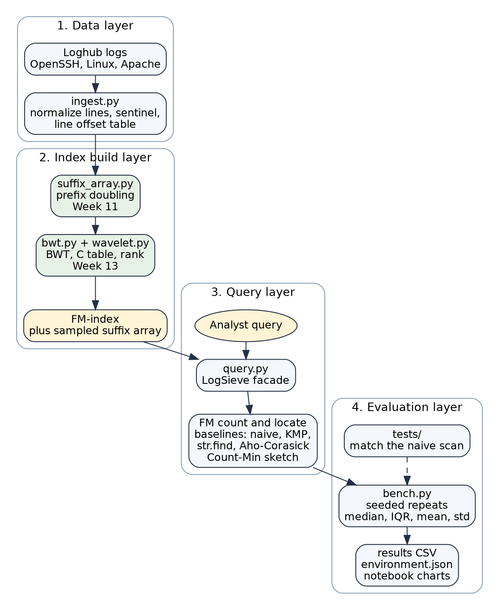

<h1>LogSieve: A Compressed Full Text Index for Fast Security Log Search</h1>

Omar Vasquez 
CSC 5300 Advanced Algorithms 
Dr. Moody Amakobe 
Concordia University Texas 
22 November 2026 
https://github.com/ovasquez-devenv/csc5300-capstone-compressed-log-search

Abstract. Security logs are long, repetitive, and searched for pieces of strings: part of an address, a user name, an error token, a fragment of an attack signature. A word index misses those pieces, and reading the file from the start for every question grows with the file. LogSieve is my compressed full text index for that search. It builds a Ferragina-Manzini index (FM-index): the Burrows-Wheeler Transform (BWT) of the log, stored in a wavelet tree, plus a sampled suffix array so a hit can be mapped back to a line. I compare count time with a plain suffix array, Knuth-Morris-Pratt (KMP), Aho-Corasick, and a naive scan. The text is the OpenSSH log from Loghub. The Week 14 prefixes are 2,000, 10,000, and 50,000 lines, timed five times on one Linux virtual machine. The largest index builds in a median of 6.24 seconds. A count on that index is faster than the scans and slower than binary search on the suffix array. The index is smaller than the suffix array, and most of that gap is Python object cost. Later weeks extend the same measurements to longer files.

## 1. Problem background

I am a retired Army veteran and I work in defense technology. A lot of the day is logs. Someone asks whether an address showed up, whether a particular user failed a password, or whether a short token from a watch list is anywhere in yesterday's record. The questions are exact. A near miss is the wrong answer. The strings are often pieces of a line, not whole tokens that an inverted index would have stored as words.

That is the problem LogSieve is for. Security and operations logs are appended text. They repeat themselves: the same daemon name, the same month, the same failure sentence with a different address dropped in. Analysts search them for substrings. A word based inverted index misses a partial address and a partial error code. A full scan answers the question, and it also rereads every byte for the next question. The cost grows with the log, and the log does not stop growing.

The constraints I am willing to accept are ordinary ones. The index must live on one machine with a normal memory budget, the kind of laptop or small server that has 8 to 16 GB of RAM. The build can take a few seconds for a few tens of thousands of lines, because a log is searched many times after it is written. The query must be exact. Approximate matching can wait. The index must say which line matched, not only how many times, because an analyst reads lines. And the method must stay understandable in Python, because this is a course project that I must be able to explain, test, and rerun.

Four research questions follow from that.

Question 1. How does FM-index count time compare with a full scan and with a plain suffix array as the log grows?

Question 2. How much space does the compressed index save against a plain suffix array on repetitive logs, once Python's real memory use is counted?

Question 3. How does the suffix array sample rate trade locate speed for memory?

Question 4. When is one pass of Aho-Corasick over the raw text the better tool, and when does the index win, for a watch list of many patterns?

## 2. Related work and industry practice

The online string algorithms are the ones I already implemented earlier in the course. Knuth, Morris, and Pratt (1977) build a failure function so a pattern of length m is found in a text of length n in O(n + m) time after an O(m) preprocess. Amakobe (2026, sec. 10.3) presents that algorithm as the basic fast scan. Aho and Corasick (1975) extend the same idea to a set of patterns. One automaton reads the text once and reports every pattern that occurs. That is the right shape for a watch list, if I am willing to reread the log whenever the list is run.

When the same text will be queried many times, the usual move is an index of the suffixes. Manber and Myers (1993) introduced the suffix array and showed how binary search on it answers a substring query. Amakobe (2026, sec. 10.5) uses the suffix array as the practical full text structure in the string chapter. Construction can be done by prefix doubling in O(n log squared n) time, which is what I use here. Kärkkäinen, Sanders, and Burkhardt (2006) later gave a linear time construction. I have not implemented that yet. It is the Week 15 replacement if the doubling sort remains the bottleneck, and the measurements below say that it is.

The compressed indexes start from a different representation of the same suffixes. Burrows and Wheeler (1994) reorder a string so that characters with similar contexts sit together. The reordered string, the BWT, is still a permutation of the original and can be inverted. Ferragina and Manzini (2000) showed that the BWT plus a rank structure supports backward search: a pattern is matched from the right, and each step is a rank query. The result is the FM-index. Count is proportional to the pattern length times the cost of rank. Locate needs a way back to text positions, which is where a sample of the suffix array comes in. Navarro and Mäkinen (2007) survey this family. Ferragina, González, Navarro, and Venturini (2009) then asked what happens when the theory is implemented and measured, using the Pizza and Chili corpus as a shared benchmark. Gog, Beller, Moffat, and Petri (2014) describe the Succinct Data Structure Library, which is the engineering answer in C++: plug the bit vectors and the wavelet trees together and the constants finally look like the papers.

The wavelet tree is the rank structure I use. Amakobe (2026, sec. 12.5.2 and sec. 12.5.3) covers the succinct bit vector and the wavelet tree. A bit vector with a rank directory answers "how many 1 bits sit before this position" in essentially constant time. A wavelet tree stacks those bit vectors so the same question can be asked of a byte alphabet. Rank of a character is then O(log sigma), where sigma is the alphabet size. I built a succinct bit vector and a wavelet tree in Week 13. LogSieve is that code's idea, rewritten so this repository stands alone, sitting on top of the suffix array and the KMP scan from Week 11.

Industry already uses the same idea in two places I care about. Langmead, Trapnell, Pop, and Salzberg (2009) built Bowtie, a short DNA aligner, on the FM-index, because a genome is a long repetitive string and the reads are short exact or nearly exact queries. Amakobe (2026, sec. 10.7) points at genomics as an application of string indexes. Logs are a different string, and the shape of the problem is the same: a long reference, many short queries, and a memory budget. Harwood (2020) describes the Elasticsearch wildcard field, which exists because people search for strings inside strings in operational data, and a normal inverted index misses a leading wildcard. This project measures the textbook structure on that kind of text.

A second, smaller thread is the streaming summary. Cormode and Muthukrishnan (2005) introduced the Count-Min sketch: a small table of counters that never underestimates a frequency and that stays within a stated error with high probability. Amakobe (2026, sec. 13.4.2) puts that sketch in the chapter on algorithms that must run in one pass over data that will not fit. I use it only as a stretch goal, to estimate which addresses appear most often while the log is read. It is not part of the substring index.

The logs themselves are from Loghub. Zhu, He, He, Liu, and Lyu (2023) collected system logs for log analytics research and published them on Zenodo. The OpenSSH log is the one I index. It is repetitive, it has the failure sentences an analyst would type, and the 2,000 line sample is small enough to commit so the tests run without a download.

What works, and what is still missing, is easy to say after that list. The compressed index literature is deep, and the engineering in C++ is real. Most of the published timings are on general text corpora and on genomes, in languages where a bit vector is a few words of memory and a rank is a handful of instructions. A small Python program that measures the same structure on security logs, with the scans and the suffix array beside it, and that records the seed, the machine, and the variance, is the gap this project fills. The goal is a correct, rerunnable measurement of the constants. Matching the Succinct Data Structure Library on speed is a different project.

Table 1. Complexity of the methods I compare. These are the bounds from the papers and from Amakobe, not the timings in section 7.

| Method | Count or scan time | Extra space | Locate | When it reads the text |
| --- | --- | --- | --- | --- |
| Naive scan | O(n m) worst case | O(1) | yes | every query |
| KMP | O(n + m) | O(m) | yes | every query |
| Aho-Corasick | O(n + patterns + hits) | the automaton | yes | one pass for many patterns |
| Suffix array | O(m log n) binary search | O(n) words | yes | once, at build |
| FM-index | O(m log sigma) | about n log sigma bits, plus samples | yes, with sample rate k | once, at build |

## 3. Proposed solution

LogSieve is a pipeline with a small number of stages, which is what Amakobe (2026, sec. 13.1 and sec. 14.1) asks for when a project moves from a paper algorithm to something that can be measured. Ingest reads a log, strips the line endings, joins the lines with a single newline, and appends one sentinel byte that is not allowed to occur in the file. It also stores the start offset of each line. A byte position then becomes a line number by binary search.

The index build sorts the suffixes with prefix doubling, derives the BWT from that suffix array, builds a wavelet tree over the BWT, and keeps every suffix array entry whose text position is a multiple of a sample rate k, plus the last position. The full suffix array is dropped after the samples exist. Count is backward search on the wavelet tree. Locate walks the Last-to-First (LF) mapping, which steps one character earlier in the text, until the walk hits a sampled position. The line offset table turns that position into a line and the line text. The facade that does this is `query.py`. The same facade is what the command line calls.

The baselines stay in the program on purpose. The naive scan, KMP, the `str.find` loop, and Aho-Corasick answer the same count question without an index. They are the controls. The Count-Min sketch sits beside them for the address summary and is not consulted during search.

An index beats a scan when the text is searched enough times to pay for the build. Section 7 measures that crossover instead of assuming it. Compression matters, in the theory, because logs repeat and the BWT gathers those repeats. In this Python prototype the space win is smaller than the theory, and section 7 reports the ratio I measured. The research version and a production version are different projects (Amakobe 2026, sec. 13.1 and sec. 14.1). This one is the research version: correct, instrumented, and small enough that I can see each stage.

## 4. Algorithms and data structures

The suffix array is built by prefix doubling. Each pass sorts suffixes by a pair of ranks that cover twice as many characters as the pass before. I sort each pair with `numpy.lexsort`, so one pass is O(n log n) and the whole build is O(n log squared n). That matches the Manber and Myers construction and Amakobe's presentation in section 10.5. The Week 15 option is the linear time algorithm of Kärkkäinen, Sanders, and Burkhardt (2006), or a pure radix doubling that removes the log factor inside each pass. Tests check the result against sorting the suffixes directly on small strings.

The BWT is one pass over the suffix array. The character in row i is the character just before suffix i, which is O(n). The inverse uses the LF mapping and is also O(n). It exists so a round trip test can fail loudly if the transform is wrong. The C table stores, for each byte, how many BWT symbols are strictly smaller. It is 256 integers.

The wavelet tree is a balanced tree on byte values. A node whose symbols are all equal collapses to a leaf, so a run of one character does not get a useless chain of bit vectors. Each internal node stores a packed bit vector. Rank samples the number of 1 bits at the start of every 512 bit block, which is the layout from Amakobe section 12.5.2. Rank and access are O(1) with a short scan of that block. Select is binary search on rank. It is implemented and tested, and the FM-index hot path uses rank, not select. A character rank walks O(log sigma) nodes. Building the tree is O(n log sigma).

Backward search then counts a pattern of length m in O(m log sigma). The search keeps a half open range of suffix array rows. Each character, from the right of the pattern, moves that range with one C lookup and two rank calls. An empty pattern is defined as one hit at every position, including the sentinel, so the tests have a single rule. A pattern longer than the text, or a pattern that never occurs, returns a count of zero.

Locate stores the rows whose text position is a multiple of k, and the final position, in sorted arrays. From a row in the match range, LF is applied until the row is one of those samples. The text position is the sampled position plus the number of steps. There are at most k steps, and each step is a rank, so one occurrence is O(k log sigma) and occ occurrences are O(occ times k log sigma). Extract uses the same walk to rebuild a slice of the text. It is tested. The search path does not need it, because the original lines are kept for display.

Space in the theory is about n machine words for a plain suffix array, and about n log sigma bits for the wavelet plus n/k samples for the FM-index. In this program I measure both the wavelet's bit entries and the bytes numpy actually allocated. The samples are four int32 arrays, so at sample rate 16 they cost about one byte per text byte on top of the packed bits. Python's list of suffix array integers is far larger than the int32 array, because each integer is an object. Table 2 is the bound I am coding toward. Section 7 is what the process actually held.

Table 2. Bounds I implement. Sigma is the alphabet size, k is the sample rate, and occ is the number of hits.

| Piece | Time | Space |
| --- | --- | --- |
| Suffix array, prefix doubling | O(n log squared n) | O(n) words during the build |
| BWT from the suffix array | O(n) | n bytes |
| Wavelet rank | O(log sigma) | O(n log sigma) bits, plus the rank directory |
| FM-index count | O(m log sigma) | the wavelet, the C table, the samples |
| FM-index locate | O(m log sigma + occ k log sigma) | n/k samples |
| Naive scan | O(n m) worst case | O(1) extra |
| KMP | O(n + m) | O(m) |
| Aho-Corasick | O(n + total pattern length + hits) | the automaton |
| Count-Min sketch | O(depth) per update or query | O((1/epsilon) log(1/delta)) counters |

The Count-Min sketch uses a fixed hash, Fowler-Noll-Vo (FNV-1a), and multipliers drawn from a seeded generator, so the table does not depend on Python's randomized `hash`. Depth and width can be set from epsilon and delta in the usual way. The estimate never goes below the true count. On a small set of addresses the exact counter is often the better structure, which is a result, not a failure of the sketch.

## 5. Architecture

Figure 1 is the path from a Loghub file to a line number, and the path the benchmarks use to decide whether that was worth it.

Figure 1. LogSieve architecture. Green boxes are ideas reused from my Week 11 string code and my Week 13 wavelet tree, rewritten in this repository.

The data layer is Loghub. Ingest normalizes lines, appends the sentinel, and builds the line offset table. The index layer is prefix doubling, then the BWT and the wavelet tree, with the sampled suffix array taken from the same suffix array before it is discarded. Those pieces are the FM-index. The query layer starts at an analyst string. The facade either runs backward search and then the line table, or it runs a baseline, or it updates the Count-Min sketch. The evaluation layer drives both sides with a seeded workload, writes the CSV files and `environment.json`, and the notebook draws the charts. The tests sit on that layer too: every engine is checked against the naive scan before a timing is kept.

## 6. Experimental plan and early results

The plan follows Amakobe (2026, sec. 14.3). Before collecting numbers I fixed the question, the competitors, the inputs, the correctness oracle, and the statistics. The oracle is the naive scan. The statistics are the mean, the sample standard deviation, the median, and the interquartile range over five trials after one warmup. The garbage collector is disabled during a timed call and run once before the trials. The seed is 5300. Pattern draws and the sketch multipliers use that seed. Wall time is `time.perf_counter`.

The machine that produced every number in this section is the one recorded in `results/environment.json` at commit `ec2004087526eb2ac9304ad10a45a65703b96240`. It is CPython 3.12.3 on Linux 6.12.113+, x86_64. The processor string from the kernel is "Intel(R) Xeon(R) Processor", with 4 CPUs. MemTotal is 16,780,623,872 bytes. I will rerun the same harness on my own PC before the final submission. If those numbers move, the tables move with them. These are the Week 14 numbers, and they are preliminary in the sense that the prefixes stop at 50,000 lines.

The text is the OpenSSH log from Loghub (Zhu et al. 2023), unpacked from the Zenodo archive `SSH.tar.gz`. The harness read the first 2,000, 10,000, and 50,000 lines. Those prefixes are 223,218 bytes, 1,098,049 bytes, and 5,561,038 bytes, sentinel included. A synthetic control of the same body length, drawn from a 41 symbol alphabet, is measured for space only. The Linux 2,000 line sample is a second real log for the space table. The query workload is random slices of length 4, 8, 16, 32, and 64, the analyst strings "Failed password", "Invalid user", "authentication failure", "error", and "Accepted", the first IPv4 address in the prefix and its three octet prefix, and the absent string "zzqxvnotpresent".

Table 3. FM-index build, five trials. Times are seconds. The suffix array phase is most of the total.

| Lines | Text bytes | Mean total | Std total | Median total | IQR total | Median suffix array |
| --- | --- | --- | --- | --- | --- | --- |
| 2,000 | 223,218 | 0.170 | 0.00118 | 0.170 | 0.000644 | 0.145 |
| 10,000 | 1,098,049 | 0.962 | 0.0325 | 0.949 | 0.0461 | 0.831 |
| 50,000 | 5,561,038 | 6.25 | 0.0812 | 6.24 | 0.0299 | 5.52 |

On the largest prefix the BWT median is 0.0299 seconds, the wavelet median is 0.191 seconds, and the sample construction median is 0.471 seconds. The fitted slope of log median total build time against log text bytes, across these three sizes, is 1.121. That is a bit above linear, which fits a doubling sort that pays an extra log factor, and three points do not prove the asymptotics. The raw fit is in `environment.json`.

Table 4. Space on the 50,000 line OpenSSH prefix, sample rate 16. Bytes are measured allocations, not a formula.

| Piece | Bytes |
| --- | --- |
| Text, with sentinel | 5,561,038 |
| Suffix array, numpy int32 | 22,244,152 |
| Suffix array, Python list of ints | 200,197,424 |
| Packed wavelet bits | 4,597,296 |
| Rank directory | 575,536 |
| Suffix array samples | 5,561,056 |
| Retained BWT array | 5,561,038 |
| FM-index, all of the above pieces plus the C table | 16,296,974 |
| FM-index without the retained BWT | 10,735,936 |

The wavelet stores 36,775,914 bit entries on that text, which is 6.61 bits per character. The synthetic control of the same length stores 6.02 bits per character. The log uses 73 distinct bytes and the synthetic text uses 41. The tree is shaped by byte values. It is not a Huffman shaped wavelet, so repetition in the log does not shrink it the way a compressed BWT coder would. The practical comparison is the three rows in Table 4: the FM-index at 16,296,974 bytes, the int32 suffix array at 22,244,152 bytes, and the Python list at 200,197,424 bytes. Dropping the raw BWT, which the wavelet can already access character by character, would leave the index at 10,735,936 bytes. I still keep the BWT array because locate uses it for the current character. The Linux 2,000 line sample is in the same CSV, at 6.68 bits per character, and it tells the same story.

Table 5. Count latency at 50,000 lines. Each entry is the median, across the workload patterns, of the per pattern median over five trials. The CSV stores seconds. I converted to milliseconds here.

| Method | Milliseconds |
| --- | --- |
| Suffix array binary search | 0.0125 |
| FM-index count | 0.147 |
| str.find loop | 2.35 |
| Naive scan | 36.8 |
| KMP | 133 |

The ordering on this prefix is suffix array, then FM-index, then `str.find`, then the naive scan, then KMP. KMP is a pure Python loop over every byte. The naive scan and `str.find` do the heavy skipping in C. A slow KMP time here is partly the interpreter. I will not treat it as a property of the 1977 algorithm. The FM-index count does not depend on how many hits there are, which is why "Failed password", with 15,385 hits on this prefix, still has an FM-index median of 0.193 milliseconds, close to the 0.147 millisecond figure in Table 5.

Break even against `str.find`, using the median build and the same median of medians, is blank at 2,000 lines because the FM-index count (0.139 milliseconds) is slower than `str.find` (0.0866 milliseconds). At 10,000 lines the build pays for itself after 2,620 count queries. At 50,000 lines the figure is 2,828 queries. Both quotients are in `results/breakeven.csv`.

Locate, for the pattern "error" with 47 hits on the 2,000 line prefix, rises with the sample rate and the sample shrinks. At k = 4 the median locate is 1.62 milliseconds and the samples are 892,896 bytes. At k = 64 the median locate is 13.1 milliseconds and the samples are 55,824 bytes. The steps in between are in `results/sample_rate_memory.csv`. This curve is the Week 14 answer to question 3. It is not yet the curve on the 50,000 line prefix.

For many patterns on the 2,000 line prefix, repeated FM-index counts are the fastest query and Aho-Corasick is the fastest way to answer once. At 100 patterns the Aho-Corasick median is 0.0250 seconds and the repeated FM-index counts are 0.00875 seconds, but the build median is 0.170 seconds. One batch is cheaper with the automaton. Dividing that build by the gap between the two query medians gives about 10.5 batches, so the index is ahead from the 11th batch of 100 patterns. Repeated KMP at 100 patterns takes a median of 0.537 seconds, which is the pure Python loop again.

The Count-Min sketch, on the 50,000 line prefix, saw 124 distinct IPv4 addresses and 47,320 updates. The exact counter occupies 13,912 bytes. A width 64, depth 4 sketch occupies 2,048 bytes and its worst overestimate is 4,827 counts. A width 1,024 sketch occupies 32,768 bytes, which is more than the exact counter, and the worst overestimate is still 379. On this address set the exact counter is the better default. The sketch is the tool for a key set that does not fit, which this log does not have.

## 7. Implementation roadmap

Week 14, which is this launch, is the proposal, the prototype, the tests, the notebook, and the prefixes above. The package builds, counts, locates, extracts, and checks every searcher against the naive scan. The command line can build a file and print the first matching lines.

Week 15 is the full implementation. The suffix array build is the bottleneck in Table 3, so that is the first change, either a radix doubling or the linear time construction, still checked against the current builder. Locate and the sample rate curve move onto the larger prefixes. Aho-Corasick and the sketch get the larger watch list, including 500 patterns, and the sketch keeps its own candidate list instead of being queried only on the exact keys. The prefixes at about 1, 2, 5, 10, and 20 MB are the size sweep, stopped wherever the machine runs out of patience, and that stopping point gets written down. Sharding a long log into blocks is the fallback if one index will not fit.

Week 16 is the final report, the threats to validity written against the final numbers, the slides, the demo, and the reproducibility checklist in Amakobe (2026, sec. 15.7). The checklist I am already trying to meet is the one in section 14.7 as well: a license, a README that says how to install and how to test, tests that pass, and the environment recorded next to the results.

Table 6. Risks I am already budgeting for.

| Risk | What I will do |
| --- | --- |
| Python memory on a long log | Cap the prefix. Store the suffix array and the bit vectors in numpy, not in lists of objects, except when the space experiment is measuring that list on purpose. |
| Build time | Keep Week 14 at 50,000 lines. Replace the doubling sort in Week 15 before the 20 MB prefixes. |
| Dataset download | Commit the 2,000 line samples. The download script checks MD5 and SHA 256 against the Zenodo record and the copies I hashed. |
| A number that came from the wrong machine | `environment.json` names the machine. Rerunning on my PC means regenerating the CSV files and the tables. |

## 8. Limitations and what I expect to contribute

The limitations are the ones Amakobe (2026, sec. 15.5) asks a project to name, and they are specific here.

Internal validity. The collector is off during timed calls, and there is a warmup, but the CPU frequency is not pinned and the file cache is warm after the first build. KMP and the FM-index walk are pure Python, while `str.find` and the naive scan's first byte skip are C. Part of Table 5 is the interpreter. I say so next to the table.

External validity. One virtual machine, one family of logs, and prefixes that stop at about 5.6 MB. A Windows PC, a different log, or a 20 MB prefix can move the constants. The ordering might survive. I will not claim that until I measure it.

Construct validity. Count latency is not locate latency, and locate is what an analyst feels when the tool prints lines. I measured locate on one pattern and one small prefix. Space in bytes is not space in theoretical bits. I report both, because they answer different questions.

Conclusion validity. Five trials is enough to see that the build times are stable. The standard deviation on the 50,000 line build is 0.081 seconds around a mean of 6.25 seconds. It is not enough to make a fine claim about two methods whose times sit within a few microseconds. I use the median and the IQR so one slow trial does not write the sentence.

What I expect to contribute is a working FM-index in Python, tied to real authentication logs, with the scans and the suffix array measured beside it under a fixed seed. The early evidence is that the index already beats a scan on count time once the log is past a few thousand lines, that it does not beat suffix array binary search on query time, that it is smaller than a Python suffix array and only somewhat smaller than an int32 one, and that a single watch list pass still belongs to Aho-Corasick. The rest of the term is there to test whether those sentences survive longer logs and a faster build.

## References

Aho, Alfred V., and Margaret J. Corasick. 1975. "Efficient String Matching: An Aid to Bibliographic Search." Communications of the ACM 18 (6): 333 to 340. https://doi.org/10.1145/360825.360855

Amakobe, Moody. 2026. Advanced Computational Algorithms: Concepts, Complexity, and Applied Projects. 2nd ed. Global Data Science Institute.

Burrows, Michael, and David J. Wheeler. 1994. "A Block-sorting Lossless Data Compression Algorithm." SRC Research Report 124. Digital Equipment Corporation, Systems Research Center, Palo Alto, CA. https://www.cl.cam.ac.uk/teaching/0304/DSAlgs/SRC-124.pdf

Cormode, Graham, and S. Muthukrishnan. 2005. "An Improved Data Stream Summary: The Count-Min Sketch and Its Applications." Journal of Algorithms 55 (1): 58 to 75. https://doi.org/10.1016/j.jalgor.2003.12.001

Ferragina, Paolo, Rodrigo González, Gonzalo Navarro, and Rossano Venturini. 2009. "Compressed Text Indexes: From Theory to Practice." ACM Journal of Experimental Algorithmics 13. https://doi.org/10.1145/1412228.1455268

Ferragina, Paolo, and Giovanni Manzini. 2000. "Opportunistic Data Structures with Applications." In Proceedings of the 41st Annual Symposium on Foundations of Computer Science, 390 to 398. IEEE. https://doi.org/10.1109/SFCS.2000.892127

Gog, Simon, Timo Beller, Alistair Moffat, and Matthias Petri. 2014. "From Theory to Practice: Plug and Play with Succinct Data Structures." In Experimental Algorithms (SEA 2014), Lecture Notes in Computer Science 8504, 326 to 337. Springer. https://doi.org/10.1007/978-3-319-07959-2_28

Harwood, Mark. 2020. "Find Strings Within Strings Faster with the New Elasticsearch Wildcard Field." Elastic Blog, 18 August 2020. https://www.elastic.co/blog/find-strings-within-strings-faster-with-the-new-elasticsearch-wildcard-field

Kärkkäinen, Juha, Peter Sanders, and Stefan Burkhardt. 2006. "Linear Work Suffix Array Construction." Journal of the ACM 53 (6): 918 to 936. https://doi.org/10.1145/1217856.1217858

Knuth, Donald E., James H. Morris, Jr., and Vaughan R. Pratt. 1977. "Fast Pattern Matching in Strings." SIAM Journal on Computing 6 (2): 323 to 350. https://doi.org/10.1137/0206024

Langmead, Ben, Cole Trapnell, Mihai Pop, and Steven L. Salzberg. 2009. "Ultrafast and Memory-Efficient Alignment of Short DNA Sequences to the Human Genome." Genome Biology 10 (3): R25. https://doi.org/10.1186/gb-2009-10-3-r25

Manber, Udi, and Gene Myers. 1993. "Suffix Arrays: A New Method for On-Line String Searches." SIAM Journal on Computing 22 (5): 935 to 948. https://doi.org/10.1137/0222058

Navarro, Gonzalo, and Veli Mäkinen. 2007. "Compressed Full-Text Indexes." ACM Computing Surveys 39 (1): Article 2. https://doi.org/10.1145/1216370.1216372

Zhu, Jieming, Shilin He, Pinjia He, Jinyang Liu, and Michael R. Lyu. 2023. "Loghub: A Large Collection of System Log Datasets for AI-driven Log Analytics." In 2023 IEEE 34th International Symposium on Software Reliability Engineering, 355 to 366. IEEE. https://doi.org/10.1109/ISSRE59848.2023.00071
